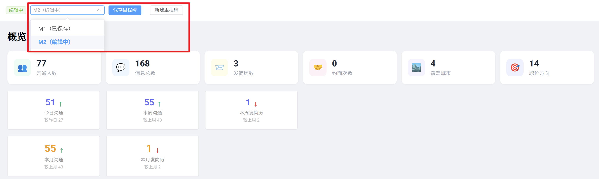
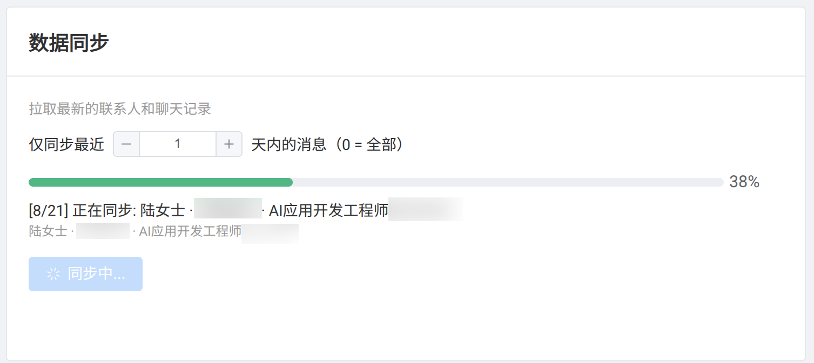
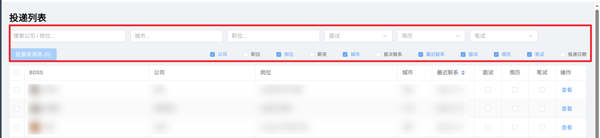
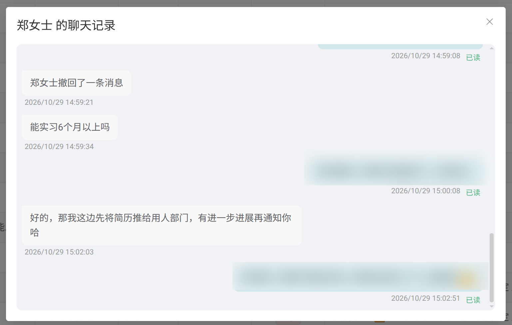
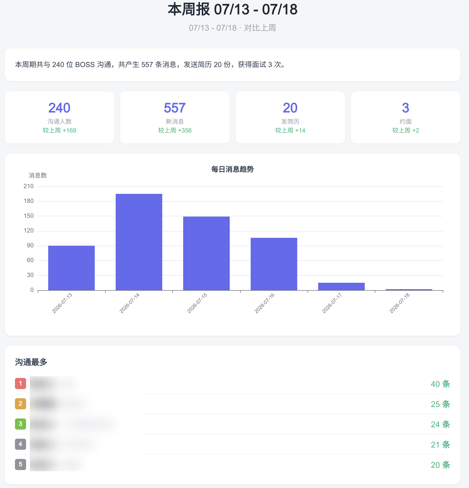
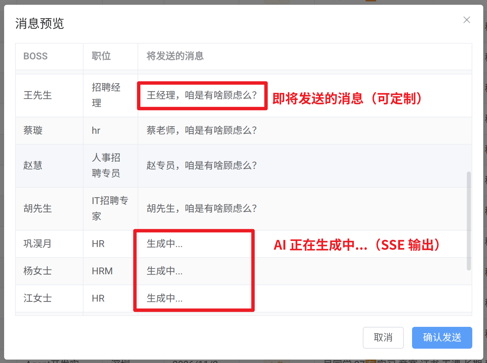
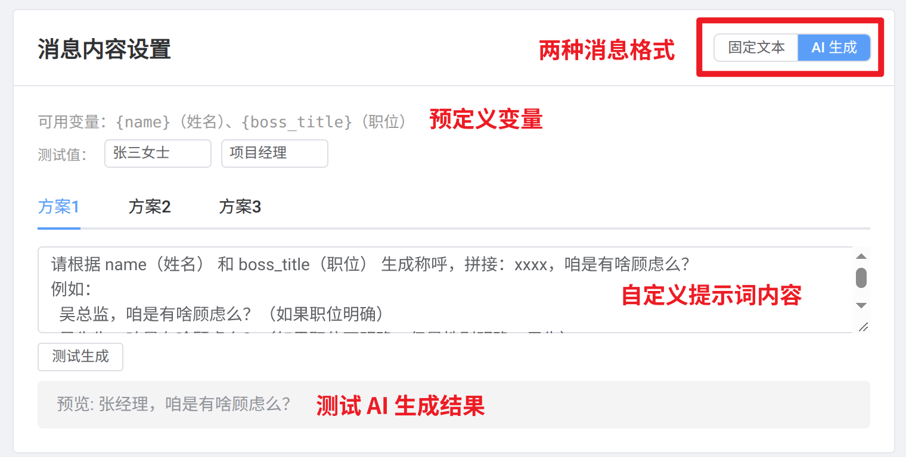
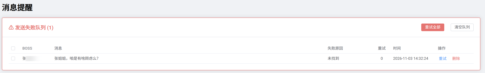
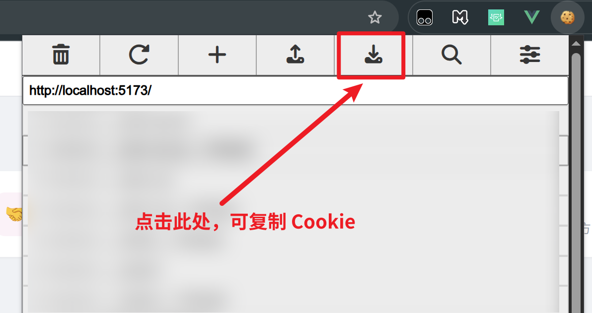
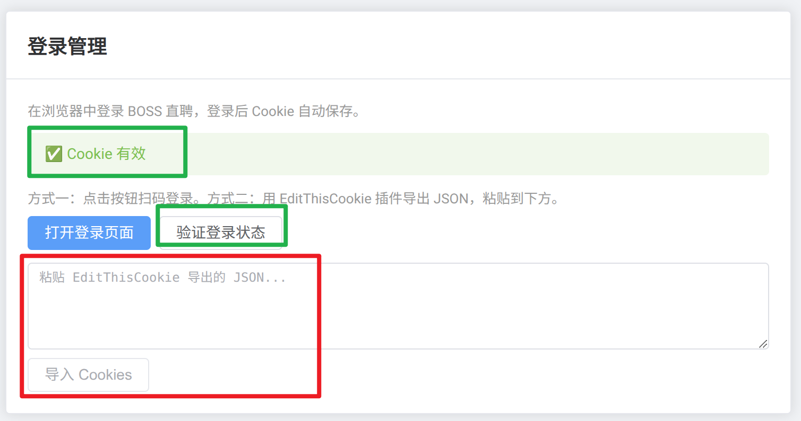

# Simple Boss Manage

面向求职者的 BOSS 直聘数据管理工具，帮助你在求职过程中更好地跟踪和管理与招聘者的沟通。支持以里程碑（M1、M2……）为单位隔离不同求职阶段的数据。


[TOC]

## 功能

### 里程碑管理
- 里程碑相当于一个独立工作区：不同里程碑的数据完全隔离，互不可见
- 先创建里程碑，再在该里程碑下同步、编辑和发送消息
- 一键「保存里程碑」将**当前数据冻结为只读**，永久保留
- 自动编号 M1、M2、M3……；新建里程碑时自动保存当前编辑中的里程碑
- 顶部工具栏可随时切换里程碑查看对应数据，选择会保存在浏览器本地
- 冻结校验由后端强制执行，只读状态下所有写操作均被拒绝



### 数据同步
- 一键同步联系人、岗位信息和聊天记录到本地 SQLite
- 支持按天数范围筛选（仅同步最近 N 天的消息）
- 自动增量更新，已有记录不重复存储；已读/未读状态变化自动更新
- 同步日志记录，可追溯每次同步的时间、数量和异常
- 智能节流：BOSS 间随机 0.5~1s 间隔，每 10 个休息 2~4s，避免触发反爬



### 投递管理
- 查看所有沟通过的 BOSS 列表，支持按城市、职位、面试/简历/笔试状态筛选
- 自定义列显示，自由选择展示字段
- 一键切换面试、简历投递、笔试状态
- 支持按首次联系、最近联系时间排序
- 岗位信息独立存储（job_info 表），包含公司全名、薪资、岗位类型、职位方向



### 聊天记录浏览
- 左右对话气泡布局，区分我方和 BOSS 的消息
- 显示文本、Emoji 表情（BOSS 雪碧图）、贴图表情（base64）
- 已读/未读状态标记
- 自动标记简历投递状态（识别附件简历发送）



### 消息提醒
- 自动识别"对方未回复"的 BOSS，按连续未回条数排序
- 支持 3 套预设消息方案（固定文本 / AI 生成），发送时可灵活切换
- AI 消息生成基于 DeepSeek，支持流式输出
- 发送失败自动记录到失败队列，支持批量重试
- Playwright 驱动真实浏览器，模拟人工操作，有反检测机制

### 统计分析
- **概览仪表盘**：沟通人数、消息总数、发简历数、约面次数、覆盖城市、职位方向
- 今日/本周/本月趋势卡片，含环比对比
- **本周每日发简历趋势**折线图
- **统计分析页**：每日沟通人数柱状图、每日发送简历趋势折线图
- 城市分布柱状图、岗位方向饼图
- 月份/周筛选器

### 报告生成
- **周报**：上周完整数据 vs 上上周
- **本周报**：本周至今 vs 上周
- **月报**：上月完整数据 vs 上上月
- **本月报**：本月至今 vs 上月
- **自定义范围**：任意日期范围，只展示统计不做对比
- HTML 报告内嵌 ECharts 每日消息趋势图、TOP 5 沟通排行
- 历史报告列表支持查看、筛选、批量删除



### 自动发消息
- 单人 / 批量自动发送消息
- 发送状态检测：DOM 中识别 `.status-loading`（5s 超时）/ `.status-error`
- 失败自动重试一次，仍失败记录到失败队列
- 姓名 + 公司 + 职位三元匹配，避免同名误发

**当准备要发送消息前，根据所选方案，会先生成即将要发送的消息，可以先预览一下，确认后再发送。** 



**发送的消息内容可以自定义，有两种消息格式，分别可设置三套方案。** 



**若消息发送失败，会进入到失败队列，可以自主选择是否重发。** 



## 技术栈

| 层 | 技术 |
|------|------|
| 前端 | Vue 3 + Element Plus + ECharts (vue-echarts) |
| 后端 | Python FastAPI + SSE 流式推送 |
| 数据库 | SQLite (WAL 模式) |
| 浏览器自动化 | Playwright (Chromium) |
| AI 消息生成 | OpenAI SDK → DeepSeek API (流式) |
| HTML 解析 | BeautifulSoup4 |

## 数据库

| 表 | 说明 |
|------|------|
| `milestones` | 里程碑（M1/M2……、active/frozen 状态、保存时间） |
| `bosses` | BOSS 信息（姓名、公司名、职位、面试/简历/笔试状态、job_id） |
| `job_info` | 岗位信息（岗位名、城市、薪资、职位方向、岗位类型、公司URL） |
| `chat_messages` | 聊天记录（body_type/content、side、status、时间戳） |
| `config` | 全局配置（Cookie、API Key、消息方案等） |
| `sync_logs` | 同步日志 |
| `message_failed_queue` | 发送失败队列（支持重试） |

除 `config` 外，业务表都带 `milestone_id`，数据按里程碑隔离；同一 BOSS 在不同里程碑中可以各自存在一条记录。旧版本数据库在启动时会自动迁移，存量数据统一归入 M1。

## 快速开始

### 1. 安装依赖

```bash
# 后端
cd backend
python -m venv venv
source venv/bin/activate
pip install -r requirements.txt
playwright install chromium

# 前端
cd frontend
npm install
```

### 2. 启动服务

```bash
# 终端 1 - 后端
uvicorn backend.main:app --reload --port 8888 --reload-exclude "*.db"

# 终端 2 - 前端
cd frontend
npm run dev
```

### 3. 安装 Cookie 插件，导入 Cookie

可以在 **Chrome 应用商店** 安装 **EditThisCookie** 插件。



复制好 Cookie 后，在设置中导入。



## 消息类型

| body_type | 含义 | 提取字段 |
|-----------|------|----------|
| 1 | 普通文本 | `body.text` |
| 3 | 面试邀请 | `body.interview.text` |
| 7 | Dialog 消息 | `body.dialog.input` |
| 12 | 附件简历 | `body.hyperLink.text`（匹配简历发送标记） |
| 14 | 面试相关 | `body.interview.text` |
| 20 | 贴图/表情 | `body.sticker.image.originImage.url` → base64 |

## 致谢

- [boss-cli](https://github.com/joohw/boss-cli) — BOSS 自动发送消息机制参考
- [GeekGeekRun](https://github.com/nicepkg/geekgeekrun) — 反检测与 Cookie 管理方案参考
